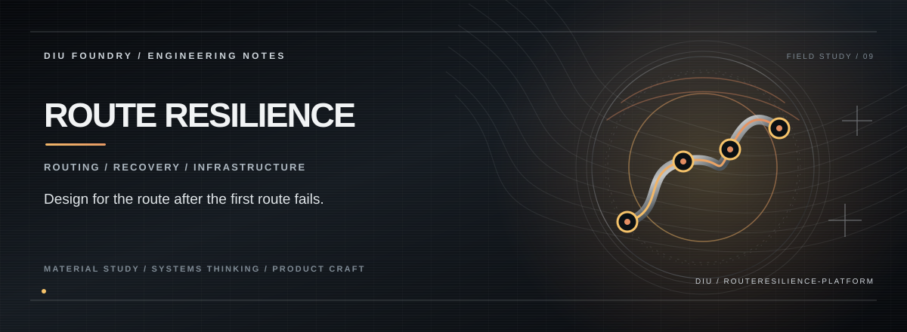

# ROUTE RESILIENCE

**An interactive geospatial product concept for exploring road-network resilience, incident planning, and route disruption scenarios.**

Route Resilience packages several planning ideas into a single interface: module overview, data upload, a digital-twin-style view, dashboard metrics, scenario simulation, and insight panels. The main experience is composed in the browser using a React context and interactive UI components. A landing-page simulation is not a validated live road network, official emergency-routing service, or operational city digital twin.

## The resilience loop

```text
Network / scenario inputs
        │
        ▼
Represent the network and operating context
        │
        ▼
Explore a disruption scenario
        │
        ▼
Compare the displayed route / system state
        │
        ▼
Review illustrative insights
```

## Interface modules

- **Upload studio:** A place to introduce data into the concept workflow.
- **Digital-twin view:** A visual surface for describing a network model.
- **Dashboard:** A summary-oriented view of the currently represented scenario.
- **Simulator:** An interactive place to explore changes and consequences.
- **Insights:** A presentation layer for scenario observations.

## Stack

React · TypeScript · Vite · TanStack Router / Start · React Query · Recharts · Tailwind CSS

## Run locally

**Requirements:** Node.js and Bun (recommended).

```bash
git clone https://github.com/Kishordiu/routeresilience-platform.git
cd routeresilience-platform
bun install
bun run dev
```

Use the local URL printed by Vite.

## Model and safety boundary

Unless a real routing engine, authoritative road data, validated disruption model, and tested integrations are connected, treat route outcomes and metrics as illustrative. Do not use the prototype for emergency dispatch, evacuation, or operational traffic decisions. Those use cases require verified data, explicit model assumptions, independent validation, and an accountable operator process.

---

<p align="center"><sub>DIU FOUNDRY · MOBILITY SYSTEMS / SCENARIO DESIGN</sub></p>
